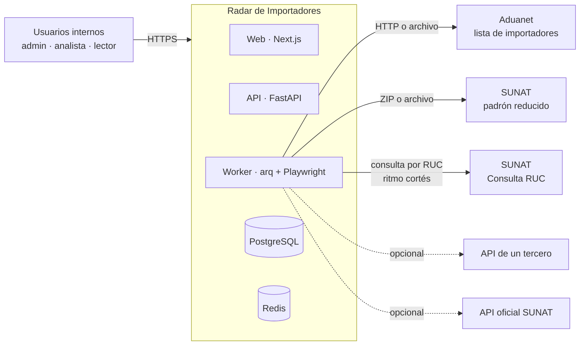
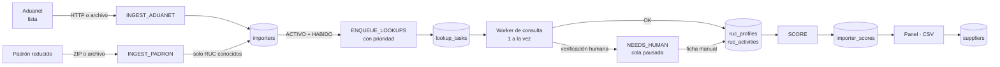
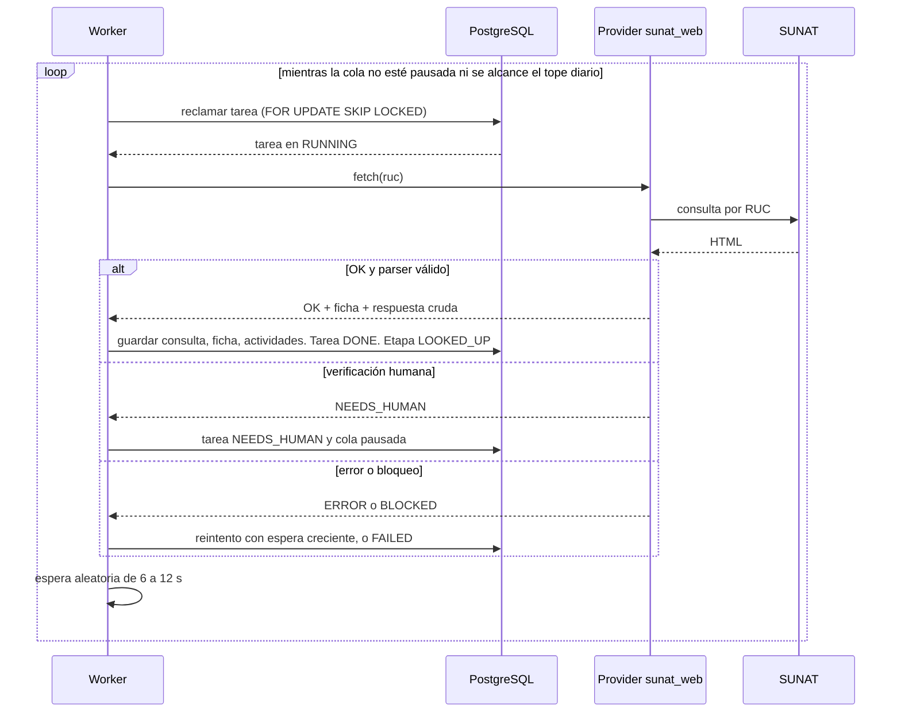
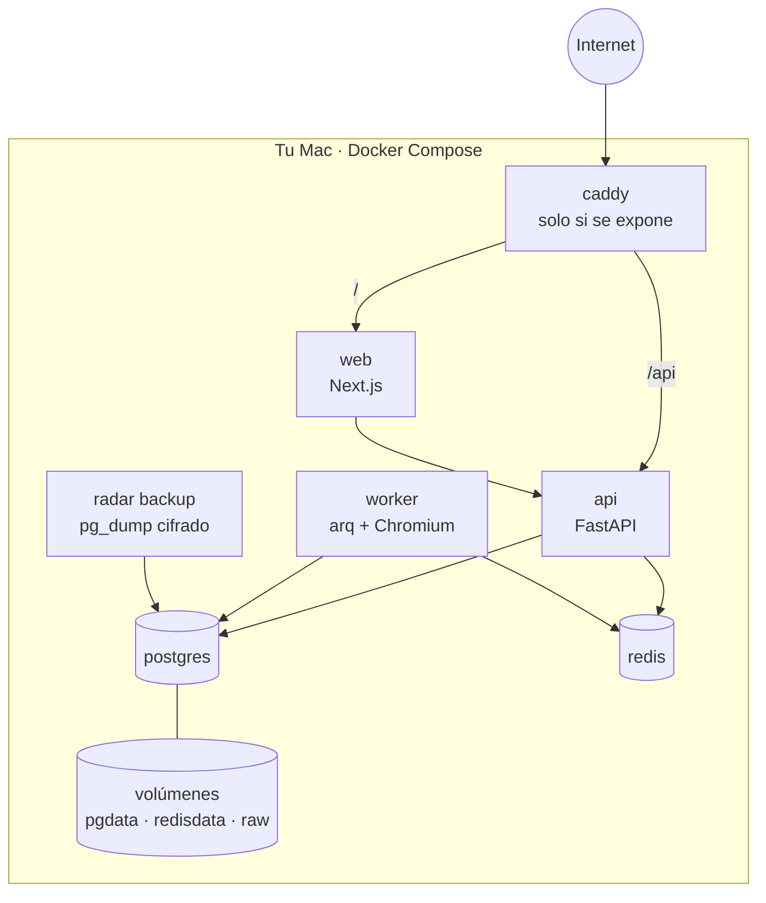

# 04 · Arquitectura de software

**Versión:** 0.2 (borrador) · **Fecha:** 25/10/2026
**Fuente:** `docs/01` a `docs/03` y las decisiones D-01 a D-09.
**Principio rector:** *simple, reanudable y cortés con las fuentes.* Es una herramienta interna para 1 a 5 personas. No necesita microservicios ni Kubernetes.

---

## 1. Vista de contexto



Lo que está **fuera** del sistema: las fuentes de SUNAT, los proveedores de pago (no se usan por ahora) y las personas que contactan a los proveedores (por WhatsApp, teléfono o correo, fuera del panel).

## 2. Estilo de arquitectura

**Monolito modular** en el backend, con **tres procesos** que comparten el mismo código y la misma base de datos:

| Proceso | Función | Imagen |
| --- | --- | --- |
| `api` | Atiende al panel por HTTP. No hace scraping | Python ligera |
| `worker` | Ejecuta ingestas, la cola de consultas, puntajes y tareas programadas | Python con Chromium (Playwright) |
| `web` | Interfaz Next.js | Node |

Un fallo del `worker` (por ejemplo, SUNAT cambia su HTML) **no afecta** a `api` ni a `web` (RNF-FIA-07).

## 3. Contenedores y tecnologías

| Capa | Tecnología | Motivo |
| --- | --- | --- |
| Interfaz | **Next.js** (App Router) + TypeScript + Tailwind + shadcn/ui + TanStack Query | Estándar, componentes accesibles, cliente generado desde OpenAPI |
| API | **FastAPI** + Pydantic v2 + SQLAlchemy 2 + Alembic | Contrato OpenAPI automático, tipado, async |
| Worker | **arq** (cola asíncrona sobre Redis) + **Playwright** | Ligero, asyncio nativo, tareas programadas incluidas |
| Parsing | `selectolax` (HTML) y `csv` en streaming (padrón) | Rápido y con poca memoria |
| Base de datos | **PostgreSQL 16** con `pg_trgm`, `unaccent`, `citext` | Búsqueda tolerante a errores sin servicio extra |
| Cola y sesiones | **Redis 7** | Dispara trabajos y guarda sesiones. **No es fuente de verdad** |
| Línea de comandos | **Typer** (`radar`) | Mismo código que el worker, sin interfaz |
| Proxy | **Caddy** | HTTPS automático. **Solo si algún día se expone fuera de tu equipo.** En local, Next.js reenvía `/api` a la API para mantener un solo origen |
| Archivos | Volumen local `/data/raw` | Archivos originales y respuestas crudas |
| Contenedores | Docker Compose | Un comando levanta todo (RNF-POR-01) |

## 4. Módulos del backend

```
radar/
├─ core/          configuración, base de datos, seguridad, registros, errores
├─ auth/          usuarios, invitaciones, sesiones, roles
├─ importers/     entidad principal, búsqueda, exclusiones, fichas
├─ ingest/        aduanet.py · padron.py · rucs.py (validación) · snapshots
├─ lookup/        cola, ritmo, providers/ (sunat_web, third_party, official_api, manual), parser
├─ scoring/       engine.py (función pura), perfiles, catálogo CIIU
├─ suppliers/     proveedores, eventos, cotizaciones, lista de verificación
├─ pipeline/      ejecuciones (runs), tareas programadas, embudo
├─ audit/         registro de auditoría
└─ cli.py         comandos `radar`
```

**Reglas de dependencia** (se verifican en la integración continua):

- `scoring` es **puro**: recibe datos y un perfil, devuelve puntaje y desglose. No toca la base de datos ni la red.
- `lookup/providers` solo conoce la interfaz `RucProvider`. Nadie más importa Playwright.
- `api` y `worker` llaman a **servicios** de cada módulo. Los routers no contienen reglas de negocio.
- Los módulos no se leen las tablas entre sí: usan los servicios del módulo dueño.

## 5. Flujo del pipeline



### 5.1 Etapas de un importador

| Etapa | Significado | Pasa a la siguiente cuando… |
| --- | --- | --- |
| `INGESTED` | Está en la lista de Aduanet con RUC válido | Se cruza con el padrón |
| `PADRON_CHECKED` | Estado y condición conocidos y **elegible** (`ACTIVO` + `HABIDO`) | Se encola una consulta |
| `QUEUED` | Tiene una tarea de consulta abierta | La consulta termina bien |
| `LOOKED_UP` | Tiene ficha completa con actividades | Se calcula un puntaje |
| `SCORED` | Tiene puntaje en el perfil activo | — |
| `DISCARDED` | Fuera del embudo, con motivo registrado | Puede **reactivarse** si el padrón nuevo lo vuelve elegible |

Motivos de descarte: `ESTADO_NO_ACTIVO`, `CONDICION_NO_HABIDO`, `NO_ENCONTRADO_EN_PADRON`, `SIN_ACTIVIDAD_IMPORTADOR`, `EXCLUIDO_MANUAL`.

### 5.2 Cola de consultas

El estado vive en **PostgreSQL** (tabla `lookup_tasks`). Redis solo avisa al worker. Si Redis se pierde, no se pierde trabajo.



Reglas de la cola:

- **Concurrencia 1** hacia SUNAT (RNF-COR-01). El worker de consultas es un único bucle.
- El estado de la cola (`paused`, `pause_reason`, `daily_cap`, `delay_min_s`, `delay_max_s`, `ttl_days`) está en `app_settings` y se cambia desde el panel.
- Una tarea `RUNNING` que lleva más de 5 minutos sin latido vuelve a `QUEUED` (recuperación tras un reinicio).
- Una sola tarea abierta por RUC (índice único parcial).
- **Prioridad** de 0 a 100 al encolar: +40 si el RUC es `20…`, +30 si el ubigeo es de Lima o Callao, y hasta +30 por palabras clave en la razón social (10 por palabra). La fecha de Aduanet no se usa (`docs/12` §2.4). Los valores y las palabras se configuran.

### 5.3 Interfaz de los proveedores de consulta

```python
class RucProvider(Protocol):
    name: str

    async def fetch(self, ruc: str) -> ProviderResult: ...

@dataclass
class ProviderResult:
    outcome: Literal["OK", "NEEDS_HUMAN", "BLOCKED", "NOT_FOUND", "PARSE_ERROR", "ERROR"]
    profile: RucProfileData | None   # solo si outcome == "OK" y el parser validó
    raw: bytes | None                # respuesta cruda para auditoría
    detail: str | None
```

| Proveedor | Estado | Notas |
| --- | --- | --- |
| `sunat_web` | **Primero** | Playwright, un RUC a la vez, ritmo cortés. Detecta el desafío de verificación y se detiene |
| `manual` | **Primero** | Formulario o pegado de texto. Resuelve `NEEDS_HUMAN` |
| `third_party` | **No se construye por ahora** (sin presupuesto, D-12) | La interfaz queda lista para agregarlo |
| `official_api` | **No se construye** (no se usa Clave SOL, D-12) | Solo si SUNAT publica un servicio oficial de consulta de RUC |

**Modo asistido** (opcional, solo cuando el worker corre en tu equipo): el navegador se abre **visible**, tú resuelves la verificación y el worker continúa. Es una persona resolviéndola, no una evasión.

### 5.4 Ingesta

- **Aduanet:** se descarga con **una solicitud simple** (`GET` sin sesión: 200 en 2.8 s, 5.5 MB, sin HTTPS) o se carga una página guardada con `--file`. Se decodifica como `windows-1252` y se acepta tanto el HTML original como el que guarda Chrome. Se parsea con `selectolax`, se valida cada RUC (dígito verificador módulo 11), se normaliza el nombre y se hace *upsert* por RUC en lotes. Las filas inválidas van a cuarentena.
- **Padrón reducido:** se lee el ZIP en **streaming**, línea por línea, sin descomprimir a disco. Se carga en memoria **solo el conjunto de RUC de nuestra lista** (decenas de miles) y se conservan únicamente las filas que coinciden. Los lotes se guardan con `COPY` a una tabla temporal y `INSERT … ON CONFLICT`. **Formato real** (`docs/12` §3.2): decodificar como ISO-8859-1, separar por `|`, descartar la columna 16 vacía, convertir `-` en nulo y mandar a cuarentena las filas con distinto número de columnas o con un RUC que no tenga 11 dígitos (hubo 5 y 1 en el archivo del 25/10).
- **Protección ante archivos defectuosos:** si el padrón trae menos filas que `padron_sanity_min_rows` (configurable), la ejecución **falla** y no descarta a nadie. Así un archivo truncado no borra el embudo.
- Cada archivo se guarda en `/data/raw` y se registra con su hash. Un mismo hash no se reprocesa.

### 5.5 Puntaje

`scoring.engine.score(facts, profile) -> ScoreResult` es una función pura. `facts` junta la ficha, las actividades, la fecha de Aduanet y el ubigeo. El resultado incluye puntaje, nivel y un desglose por criterio. Se persiste en `importer_scores` junto con el `profile_id` (cada versión del perfil es una fila distinta), lo que permite **reproducir** cualquier número (RNF-DAT-06).

### 5.6 Tareas programadas (arq cron)

| Tarea | Frecuencia por defecto | Qué hace |
| --- | --- | --- |
| `refresh_aduanet` | Semanal, madrugada | Descarga y procesa la lista |
| `refresh_padron` | Semanal, madrugada | Actualiza estado y condición, y registra cambios |
| `refresh_supplier_status` | Diaria | Revisa los proveedores aprobados y en verificación |
| `backup_check` | Diaria | Confirma que el respaldo del día existe |

Todas se pueden apagar desde `app_settings`. **En tu Mac solo corren si el worker está encendido**: con el equipo en suspensión la cola se detiene y se reanuda sola. Cuando los datos tienen más de 14 días, el panel muestra el aviso `DATA_STALE`.

## 6. Despliegue



### 6.1 Dónde corre el worker (por validar en el spike)

**Decisión del 25/10/2026 (D-11): opción A, todo en tu Mac.** Desde el entorno de desarrollo Aduanet rechazó la conexión, por una causa que no era un bloqueo (`docs/12` §2.2). Desde tu Mac, la lista de Aduanet y el padrón se descargaron sin problema. Las opciones B y C quedan como ruta futura, solo si hiciera falta:

| Opción | Cuándo | Pros | Contras |
| --- | --- | --- | --- |
| **A. Todo en tu equipo** (Docker Compose) | **Elegida** | Sale con una IP peruana residencial, permite el modo asistido y no cuesta nada | El panel no está disponible si apagas el equipo |
| **B. Todo en un VPS** | H5, si el spike confirma que el VPS llega a SUNAT y Aduanet | Siempre disponible, accesible para el equipo | Puede ser bloqueado. Sin modo asistido |
| **C. Híbrido** | Si B falla | Panel en el VPS y worker en tu equipo, hablando con la misma base de datos por un túnel cifrado | Más piezas que mantener |

En cualquier opción existe la **ingesta por archivo cargado**, así que un bloqueo no detiene el proyecto.

### 6.2 Entornos

| Entorno | Para qué | Datos |
| --- | --- | --- |
| `local` | Desarrollo | Fixtures y datos sintéticos |
| `staging` (opcional) | Probar despliegues | Copia reducida |
| `prod` | Uso real | Datos reales |

### 6.3 Variables de entorno principales

| Variable | Ejemplo / valor por defecto | Descripción |
| --- | --- | --- |
| `DATABASE_URL` | `postgresql+psycopg://…` | Conexión a PostgreSQL |
| `REDIS_URL` | `redis://redis:6379/0` | Redis |
| `SECRET_KEY` | *(generada, no se versiona)* | Firma y cifrado de la aplicación |
| `APP_BASE_URL` | `https://radar.ejemplo.pe` | Para enlaces de invitación |
| `ADUANET_LIST_URL` | `http://www.aduanet.gob.pe/servlet/CGLisImp?flag=1&nom` | Lista de importadores (sin «t» en `CGLisImp`). Solo HTTP |
| `PADRON_URL` | `http://www2.sunat.gob.pe/padron_reducido_ruc.zip` | Archivo del padrón reducido (enlace de la página oficial, `docs/12` §3.1) |
| `LOOKUP_PROVIDER` | `sunat_web` | `sunat_web`, `third_party` u `official_api` |
| `LOOKUP_DELAY_MIN_S` / `LOOKUP_DELAY_MAX_S` | `6` / `12` | Espera entre consultas |
| `LOOKUP_DAILY_CAP` | `400` | Tope diario |
| `LOOKUP_TTL_DAYS` | `30` | Caché de fichas |
| `THIRD_PARTY_API_KEY` | *(opcional)* | Solo si se usa un tercero |
| `RAW_DATA_DIR` | `/data/raw` | Archivos originales |
| `TZ` | `America/Lima` | Zona horaria de las tareas |
| `BIND_HOST` | `127.0.0.1` | Interfaz donde escuchan la API y el panel. No cambiar sin HTTPS |
| `COOKIE_SECURE` | `false` en local | Se pone en `true` cuando hay HTTPS |
| `PADRON_KEEP_FILES` | `1` | Cuántos archivos del padrón se conservan |

### 6.4 Modo local y huella en disco

- **Solo en tu Mac:** la API, el panel y la base de datos escuchan en `127.0.0.1`. Nada queda expuesto a tu red ni a internet.
- **Espacio:** hay cuatro consumos: imágenes de Docker, base de datos, archivos originales y el navegador del worker. Una estimación gruesa, **que se mide en el spike (SP-11)**, es de 3 a 5 GB. Para reducirlo: (1) guardar solo el último archivo del padrón, (2) correr API, worker y panel **fuera de Docker** y dejar en Docker solo PostgreSQL y Redis, (3) borrar las respuestas crudas con más de 12 meses.
- **Suspensión:** si el Mac se duerme, la cola se detiene y se reanuda al despertar. Las tareas `RUNNING` sin latido vuelven a `QUEUED`.
- **Respaldo:** `radar backup` genera una copia cifrada de la base de datos. Dónde guardarla está en `docs/01` §9.3 b.

## 7. Resiliencia y errores

| Situación | Comportamiento |
| --- | --- |
| Reinicio del worker | Las tareas `RUNNING` sin latido vuelven a `QUEUED`. Nada se pierde |
| SUNAT no responde | Reintento con espera creciente (1, 5 y 15 min) y luego `FAILED` |
| 403, 429 o desafío de verificación | Cola **pausada**, aviso en el panel, sin reintentar |
| HTML distinto al esperado | `PARSE_ERROR`: no se guarda la ficha, se conserva la respuesta cruda y se alerta |
| Redis caído | El panel sigue leyendo. Las sesiones nuevas fallan. Al volver, el worker retoma desde la base de datos |
| PostgreSQL caído | `/ready` falla, el panel muestra una pantalla de mantenimiento |
| Padrón truncado | La ejecución falla sin descartar a nadie |

## 8. Pruebas

| Nivel | Qué cubre | Herramienta |
| --- | --- | --- |
| Unitarias | Validación de RUC, normalización, puntaje, prioridades | `pytest` |
| Parsers | HTML guardado de Aduanet y de la consulta RUC. Incluye el caso `20526185847` (4 filas y baja de oficio) | `pytest` con *fixtures* |
| Contrato de proveedores | Cualquier proveedor cumple `RucProvider` | `pytest` parametrizado |
| Integración | API contra PostgreSQL real, cola, reanudación tras reinicio | `pytest` + Testcontainers |
| Contrato de API | El esquema OpenAPI no cambia sin aviso | Comparación del archivo generado |
| Interfaz | Componentes y flujos principales | Vitest y Playwright |
| Humo en vivo | Una consulta real a un RUC conocido, **manual y fuera de la integración continua** | Comando `radar smoke` |

Los parsers **nunca** se prueban contra SUNAT en vivo en la integración continua (RNF-MAN-02).

## 9. Registro de decisiones (ADR)

| ID | Decisión | Alternativas | Por qué | Consecuencia |
| --- | --- | --- | --- | --- |
| ADR-01 | Monolito modular con tres procesos | Microservicios | Equipo pequeño y un solo dominio | Menos piezas. Reglas de dependencia verificadas en la integración continua |
| ADR-02 | PostgreSQL es la fuente de verdad. Redis solo dispara trabajos y guarda sesiones | Cola solo en Redis | Reanudable y auditable (RNF-FIA-02) | Se consulta la base de datos para reclamar tareas |
| ADR-03 | Padrón procesado en streaming y filtrado por nuestra lista | Cargar 18.5 M de filas | Memoria ≤ 512 MB y menos disco | Para reportes de otros RUC hay que reprocesar |
| ADR-04 | Proveedores de consulta intercambiables | Código atado a SUNAT web | Riesgos R-02 y R-03 | Un cambio de fuente no toca el resto |
| ADR-05 | No evadir captchas ni bloqueos | Servicios de resolución, rotación de IP | Política del proyecto y cumplimiento | Más trabajo manual. Menor velocidad, menor riesgo |
| ADR-06 | Sesiones con cookie opaca en Redis | JWT en el navegador | Revocables y sin datos en el cliente | Redis es necesario para iniciar sesión |
| ADR-07 | `arq` para trabajos | Celery, RQ | Asyncio, Playwright asíncrono y *cron* integrado | Comunidad más pequeña que Celery |
| ADR-08 | Cliente TypeScript generado desde OpenAPI | Tipos escritos a mano | Un solo contrato (RNF-MAN-06) | Se regenera al cambiar la API |
| ADR-09 | Búsqueda con `pg_trgm` + `unaccent` | Elasticsearch o Meilisearch | Basta para decenas de miles de filas | Sin servicio extra que mantener |
| ADR-10 | Puntaje como función pura con perfiles versionados | Reglas dispersas | Explicable y reproducible | Cada cambio de peso crea una versión nueva |
| ADR-11 | Primero un CSV por CLI, después el panel | Todo junto | El primer lote de iPhone no espera (D-08) | Parte del código del pipeline se prueba antes de la interfaz |
| ADR-12 | Todo corre en tu Mac, sin VPS | VPS con Caddy y HTTPS | Un solo usuario, costo cero y salida con tu IP peruana (D-10, D-11) | El panel no está disponible con el Mac apagado. El despliegue en servidor queda como ruta futura |
| ADR-13 | Sin proveedores de pago ni Clave SOL por ahora | API de terceros, API oficial | No hay presupuesto y la Clave SOL expone la cuenta tributaria (D-12) | La interfaz `RucProvider` deja la puerta abierta |
| ADR-14 | Avisos como tabla `alerts` mostrada en el panel | Correo, WhatsApp | Un solo usuario que ya está mirando el panel (D-15) | Si no abres el panel, no te enteras |
