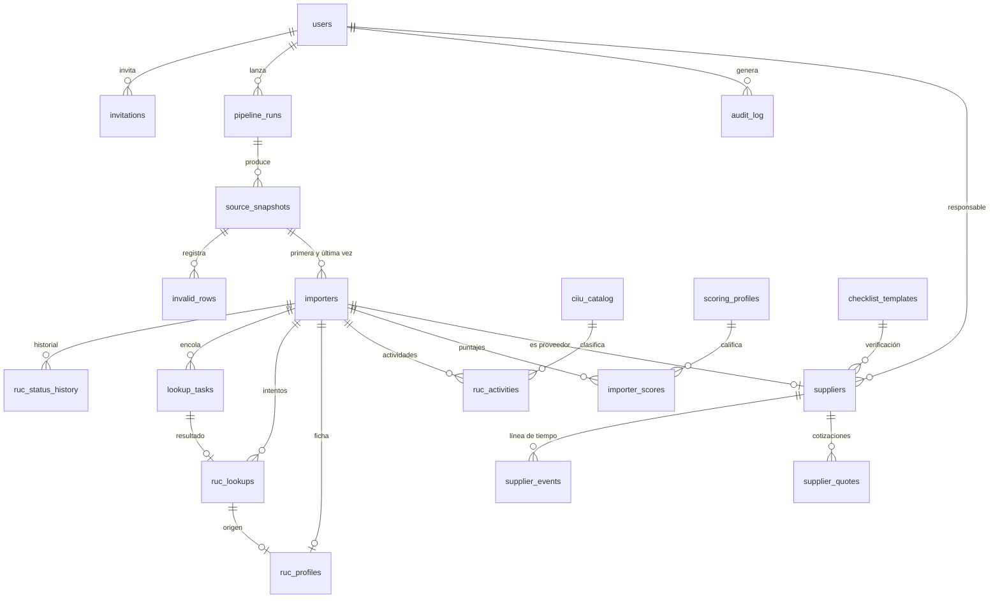

# 05 · Modelo de datos

**Versión:** 0.2 (borrador) · **Fecha:** 25/10/2026
**Motor:** PostgreSQL 16 · **Migraciones:** Alembic.
**Convenciones:** identificadores en inglés; campos del dominio SUNAT en español (`ruc`, `razon_social`, `estado`, `condicion`, `ubigeo`). Fechas en `timestamptz` (UTC) y `date` para fechas de SUNAT. Los valores «enum» son `text` con `CHECK`, para poder agregar valores sin migraciones dolorosas.

---

## 1. Diagrama entidad-relación



## 2. Extensiones

```sql
CREATE EXTENSION IF NOT EXISTS pg_trgm;   -- búsqueda tolerante a errores
CREATE EXTENSION IF NOT EXISTS unaccent;  -- sin tildes
CREATE EXTENSION IF NOT EXISTS citext;    -- correos sin distinguir mayúsculas
```

## 3. Acceso y operación

```sql
CREATE TABLE users (
  id             uuid PRIMARY KEY DEFAULT gen_random_uuid(),
  email          citext NOT NULL UNIQUE,
  name           text NOT NULL,
  password_hash  text,                       -- Argon2id. NULL hasta aceptar la invitación
  role           text NOT NULL CHECK (role IN ('admin','analyst','viewer')),
  is_active      boolean NOT NULL DEFAULT true,
  totp_secret_enc bytea,                     -- futuro (RF-AUT-06)
  failed_logins  int NOT NULL DEFAULT 0,
  locked_until   timestamptz,
  last_login_at  timestamptz,
  created_at     timestamptz NOT NULL DEFAULT now(),
  updated_at     timestamptz NOT NULL DEFAULT now()
);

CREATE TABLE invitations (
  id          uuid PRIMARY KEY DEFAULT gen_random_uuid(),
  email       citext NOT NULL,
  role        text NOT NULL CHECK (role IN ('admin','analyst','viewer')),
  token_hash  char(64) NOT NULL UNIQUE,      -- SHA-256 del token. El token nunca se guarda
  invited_by  uuid NOT NULL REFERENCES users(id),
  expires_at  timestamptz NOT NULL,
  accepted_at timestamptz,
  created_at  timestamptz NOT NULL DEFAULT now()
);

CREATE TABLE pipeline_runs (
  id           bigserial PRIMARY KEY,
  kind         text NOT NULL CHECK (kind IN
               ('INGEST_ADUANET','INGEST_PADRON','ENQUEUE_LOOKUPS','SCORE','REFRESH_STATUS')),
  status       text NOT NULL DEFAULT 'QUEUED' CHECK (status IN
               ('QUEUED','RUNNING','SUCCEEDED','FAILED','CANCELLED')),
  params       jsonb NOT NULL DEFAULT '{}',
  stats        jsonb NOT NULL DEFAULT '{}',   -- filas leídas, nuevas, inválidas, descartadas…
  error        text,
  triggered_by uuid REFERENCES users(id),     -- NULL = sistema (tarea programada)
  started_at   timestamptz,
  finished_at  timestamptz,
  created_at   timestamptz NOT NULL DEFAULT now()
);

CREATE TABLE app_settings (
  key         text PRIMARY KEY,
  value       jsonb NOT NULL,
  updated_by  uuid REFERENCES users(id),
  updated_at  timestamptz NOT NULL DEFAULT now()
);
-- Claves: lookup_queue, priority_rules, padron_sanity_min_rows, schedules, default_profile_key

CREATE TABLE audit_log (
  id          bigserial PRIMARY KEY,
  user_id     uuid REFERENCES users(id),      -- NULL = sistema
  action      text NOT NULL,                  -- LOGIN, LOGIN_FAILED, RUN_START, EXPORT, SUPPLIER_APPROVE…
  entity_type text,
  entity_id   text,
  meta        jsonb NOT NULL DEFAULT '{}',
  ip          inet,
  user_agent  text,
  created_at  timestamptz NOT NULL DEFAULT now()
);
CREATE INDEX ix_audit_created ON audit_log (created_at DESC);
CREATE INDEX ix_audit_user ON audit_log (user_id, created_at DESC);
```

```sql
CREATE TABLE alerts (                         -- avisos que se muestran en el panel (D-15)
  id           bigserial PRIMARY KEY,
  kind         text NOT NULL CHECK (kind IN
               ('QUEUE_PAUSED','PARSER_BROKEN','SUPPLIER_STATUS_CHANGED','DATA_STALE','BACKUP_MISSING')),
  severity     text NOT NULL CHECK (severity IN ('info','warning','danger')),
  title        text NOT NULL,
  body         text,
  entity_type  text,                          -- 'supplier', 'importer', 'run'…
  entity_id    text,
  created_at   timestamptz NOT NULL DEFAULT now(),
  resolved_at  timestamptz,                   -- el sistema lo cierra cuando la causa desaparece
  dismissed_by uuid REFERENCES users(id),
  dismissed_at timestamptz
);
CREATE INDEX ix_alerts_open ON alerts (created_at DESC)
  WHERE resolved_at IS NULL AND dismissed_at IS NULL;
```

Las **sesiones** no están en PostgreSQL: viven en Redis con vencimiento (ver `docs/07`).

> En la primera versión hay **un solo usuario** (`admin`, creado con `radar admin create`). La tabla `invitations` y los roles `analyst` y `viewer` ya están en el modelo para cuando se sume más gente (D-10).

## 4. Fuentes y universo de importadores

```sql
CREATE TABLE source_snapshots (
  id           bigserial PRIMARY KEY,
  source       text NOT NULL CHECK (source IN ('ADUANET_LIST','PADRON_REDUCIDO')),
  origin       text NOT NULL CHECK (origin IN ('FETCH','UPLOAD')),
  source_date  date,                          -- fecha que declara la fuente (p. ej. 24/10/2026)
  fetched_at   timestamptz NOT NULL DEFAULT now(),
  file_path    text NOT NULL,
  file_sha256  char(64) NOT NULL,
  row_count    int,
  new_rows     int,
  invalid_rows int,
  status       text NOT NULL DEFAULT 'PROCESSING' CHECK (status IN ('PROCESSING','DONE','FAILED')),
  run_id       bigint REFERENCES pipeline_runs(id),
  UNIQUE (source, file_sha256)                -- el mismo archivo no se reprocesa
);

CREATE TABLE invalid_rows (                   -- cuarentena (RF-ING-04)
  id          bigserial PRIMARY KEY,
  snapshot_id bigint NOT NULL REFERENCES source_snapshots(id) ON DELETE CASCADE,
  line_no     int,
  raw_ruc     text,
  raw_name    text,
  reason      text NOT NULL                   -- FORMATO_RUC, PREFIJO_INVALIDO, DIGITO_VERIFICADOR_INVALIDO, VACIO
);

CREATE TABLE importers (
  ruc                 char(11) PRIMARY KEY CHECK (ruc ~ '^[0-9]{11}$'),
  razon_social        text NOT NULL,          -- limpia (sin comillas ni espacios sobrantes)
  razon_social_norm   text NOT NULL,          -- MAYÚSCULAS, sin tildes ni signos, para búsqueda
  ruc_kind            text GENERATED ALWAYS AS (
                        CASE left(ruc, 2) WHEN '20' THEN 'JURIDICA'
                                          WHEN '10' THEN 'NATURAL' ELSE 'OTRO' END) STORED,
  aduanet_last_update date,                   -- la más reciente entre las apariciones
  aduanet_appearances int NOT NULL DEFAULT 1, -- cuántas veces aparece en la lista
  first_snapshot_id   bigint REFERENCES source_snapshots(id),
  last_snapshot_id    bigint REFERENCES source_snapshots(id),

  stage               text NOT NULL DEFAULT 'INGESTED' CHECK (stage IN
                      ('INGESTED','PADRON_CHECKED','QUEUED','LOOKED_UP','SCORED','DISCARDED')),
  discard_reason      text CHECK (discard_reason IN
                      ('ESTADO_NO_ACTIVO','CONDICION_NO_HABIDO','NO_ENCONTRADO_EN_PADRON',
                       'SIN_ACTIVIDAD_IMPORTADOR','EXCLUIDO_MANUAL')),

  -- Vigentes según el último padrón (denormalizados para filtrar rápido)
  estado              text,
  condicion           text,
  ubigeo              char(6),
  direccion_fiscal    text,
  status_checked_at   timestamptz,

  priority            smallint NOT NULL DEFAULT 0 CHECK (priority BETWEEN 0 AND 100),

  excluded            boolean NOT NULL DEFAULT false,
  excluded_reason     text,
  excluded_by         uuid REFERENCES users(id),
  excluded_at         timestamptz,

  created_at          timestamptz NOT NULL DEFAULT now(),
  updated_at          timestamptz NOT NULL DEFAULT now(),

  CHECK ((stage = 'DISCARDED') = (discard_reason IS NOT NULL))
);
CREATE INDEX ix_importers_stage     ON importers (stage);
CREATE INDEX ix_importers_estado    ON importers (estado, condicion);
CREATE INDEX ix_importers_priority  ON importers (priority DESC) WHERE stage = 'PADRON_CHECKED';
CREATE INDEX ix_importers_name_trgm ON importers USING gin (razon_social_norm gin_trgm_ops);

CREATE TABLE ruc_status_history (             -- solo se inserta cuando algo cambia (RF-ING-08)
  id               bigserial PRIMARY KEY,
  ruc              char(11) NOT NULL REFERENCES importers(ruc),
  snapshot_id      bigint REFERENCES source_snapshots(id),
  estado           text NOT NULL,
  condicion        text NOT NULL,
  ubigeo           char(6),
  direccion_fiscal text,
  observed_at      timestamptz NOT NULL DEFAULT now()
);
CREATE INDEX ix_status_hist ON ruc_status_history (ruc, observed_at DESC);
```

**Reglas de la etapa:**

- `DISCARDED` siempre lleva `discard_reason` y viceversa (restricción `CHECK`).
- Una empresa descartada **se reactiva** si el padrón siguiente la vuelve `ACTIVO` + `HABIDO` (pasa a `PADRON_CHECKED`, o a `LOOKED_UP` si ya tenía ficha).
- Un `EXCLUIDO_MANUAL` **no se reactiva solo**: hay que restaurarlo a mano.
- Valores de `estado` y `condicion`: se guardan **tal como vienen en el padrón** (en mayúsculas, sin espacios sobrantes y **truncados a 20 caracteres** por SUNAT, por ejemplo `BAJA PROV. POR OFICI`). El filtro compara con los valores exactos `ACTIVO` y `HABIDO`. Lista real en `docs/12` §3.4.
- `ubigeo` y los demás campos que el padrón trae como `-` se guardan como **nulos**. El 85 % de las filas del padrón no trae ubigeo (probablemente las personas naturales), así que el criterio de logística da 0 puntos cuando falta.
- Las filas del padrón con distinto número de columnas o con un RUC que no tenga 11 dígitos se registran en `invalid_rows` y no se cargan.

## 5. Consultas y fichas

```sql
CREATE TABLE lookup_tasks (
  id               bigserial PRIMARY KEY,
  ruc              char(11) NOT NULL REFERENCES importers(ruc),
  status           text NOT NULL DEFAULT 'QUEUED' CHECK (status IN
                   ('QUEUED','RUNNING','DONE','FAILED','NEEDS_HUMAN','CANCELLED')),
  provider         text NOT NULL DEFAULT 'sunat_web',
  priority         smallint NOT NULL DEFAULT 0,
  attempts         smallint NOT NULL DEFAULT 0,
  next_run_at      timestamptz NOT NULL DEFAULT now(),
  forced           boolean NOT NULL DEFAULT false,   -- reconsulta pedida por una persona
  requested_by     uuid REFERENCES users(id),
  last_error       text,
  heartbeat_at     timestamptz,
  result_lookup_id bigint,                           -- FK a ruc_lookups, se agrega abajo
  created_at       timestamptz NOT NULL DEFAULT now(),
  started_at       timestamptz,
  finished_at      timestamptz
);
-- Una sola tarea abierta por RUC
CREATE UNIQUE INDEX ux_lookup_open ON lookup_tasks (ruc)
  WHERE status IN ('QUEUED','RUNNING','NEEDS_HUMAN');
-- Reclamo ordenado por prioridad
CREATE INDEX ix_lookup_claim ON lookup_tasks (priority DESC, next_run_at) WHERE status = 'QUEUED';

CREATE TABLE ruc_lookups (                    -- cada intento, bueno o malo
  id          bigserial PRIMARY KEY,
  ruc         char(11) NOT NULL REFERENCES importers(ruc),
  task_id     bigint REFERENCES lookup_tasks(id),
  provider    text NOT NULL CHECK (provider IN ('sunat_web','third_party','official_api','manual')),
  outcome     text NOT NULL CHECK (outcome IN
              ('OK','PARSE_ERROR','NEEDS_HUMAN','NOT_FOUND','BLOCKED','ERROR')),
  http_status int,
  duration_ms int,
  raw_path    text,                           -- respuesta cruda en /data/raw (nunca se renderiza)
  error       text,
  entered_by  uuid REFERENCES users(id),      -- solo para 'manual'
  fetched_at  timestamptz NOT NULL DEFAULT now()
);
CREATE INDEX ix_lookups_ruc ON ruc_lookups (ruc, fetched_at DESC);
ALTER TABLE lookup_tasks
  ADD CONSTRAINT fk_task_result FOREIGN KEY (result_lookup_id) REFERENCES ruc_lookups(id);

CREATE TABLE ruc_profiles (                   -- la ficha vigente de cada RUC (una por RUC)
  ruc                      char(11) PRIMARY KEY REFERENCES importers(ruc),
  lookup_id                bigint NOT NULL REFERENCES ruc_lookups(id),
  source                   text NOT NULL CHECK (source IN
                           ('SUNAT_WEB','THIRD_PARTY','OFFICIAL_API','MANUAL')),
  razon_social             text,
  tipo_contribuyente       text,
  nombre_comercial         text,
  fecha_inscripcion        date,
  fecha_inicio_actividades date,
  estado                   text NOT NULL,
  fecha_baja               date,
  condicion                text NOT NULL,
  domicilio_fiscal         text,
  sistema_emision          text,
  comercio_exterior        text[] NOT NULL DEFAULT '{}',   -- {'IMPORTADOR','EXPORTADOR'}
  sistema_contabilidad     text,
  comprobantes_autorizados text[] NOT NULL DEFAULT '{}',   -- {'FACTURA','BOLETA DE VENTA',…}
  emisor_electronico_desde date,                           -- POR CONFIRMAR: no se ve en la captura
  fetched_at               timestamptz NOT NULL
);

CREATE TABLE ciiu_catalog (
  code        char(4) PRIMARY KEY,
  description text NOT NULL,
  relevance   text NOT NULL DEFAULT 'NONE' CHECK (relevance IN
              ('ELECTRONICS_CORE','ELECTRONICS_RETAIL','ELECTRONICS_RELATED','NONE')),
  weight      numeric(3,2) NOT NULL DEFAULT 0 CHECK (weight BETWEEN 0 AND 1),
  updated_by  uuid REFERENCES users(id),
  updated_at  timestamptz NOT NULL DEFAULT now()
);

CREATE TABLE ruc_activities (
  id          bigserial PRIMARY KEY,
  ruc         char(11) NOT NULL REFERENCES importers(ruc),
  kind        text NOT NULL CHECK (kind IN ('PRINCIPAL','SECUNDARIA')),
  position    smallint NOT NULL DEFAULT 0,    -- 0 para la principal; 1, 2… para secundarias
  ciiu_code   char(4) NOT NULL,
  description text,
  UNIQUE (ruc, kind, position)
);
CREATE INDEX ix_activities_ciiu ON ruc_activities (ciiu_code);
```

**Notas:**

- `ruc_activities.ciiu_code` **no** tiene clave foránea al catálogo. SUNAT puede devolver códigos que aún no cargamos; en ese caso cuentan con peso 0 y se muestran en una lista de «códigos sin clasificar» para revisarlos.
- Actualizar una ficha es **transaccional**: se reemplazan la fila de `ruc_profiles` y todas sus `ruc_activities` en una sola transacción. Si el parser falla, no se toca nada (RNF-DAT-03).
- `emisor_electronico_desde` está pendiente: la captura se corta en «Comprobantes de pago» y no vimos los campos de emisión electrónica. Se confirma en el spike con la página completa.

## 6. Puntaje

```sql
CREATE TABLE scoring_profiles (
  id          serial PRIMARY KEY,
  key         text NOT NULL,                  -- 'smartphones', 'laptops'
  name        text NOT NULL,                  -- 'Smartphones / iPhone'
  version     int NOT NULL,
  config      jsonb NOT NULL,                 -- ver §6.1
  is_active   boolean NOT NULL DEFAULT false,
  created_by  uuid REFERENCES users(id),
  created_at  timestamptz NOT NULL DEFAULT now(),
  UNIQUE (key, version)
);
-- Solo una versión activa por tipo de producto
CREATE UNIQUE INDEX ux_profile_active ON scoring_profiles (key) WHERE is_active;

CREATE TABLE importer_scores (
  ruc         char(11) NOT NULL REFERENCES importers(ruc),
  profile_id  int NOT NULL REFERENCES scoring_profiles(id),
  score       smallint NOT NULL CHECK (score BETWEEN 0 AND 100),
  tier        char(1) NOT NULL CHECK (tier IN ('A','B','C','D')),
  breakdown   jsonb NOT NULL,
  computed_at timestamptz NOT NULL DEFAULT now(),
  PRIMARY KEY (ruc, profile_id)
);
CREATE INDEX ix_scores_rank ON importer_scores (profile_id, score DESC);
```

### 6.1 Contenido de `config` (perfil «Smartphones / iPhone v1»)

```json
{
  "gates": {
    "estado": ["ACTIVO"],
    "condicion": ["HABIDO"],
    "comercio_exterior_requiere": ["IMPORTADOR"]
  },
  "criteria": {
    "rubro": { "max": 40, "secondary_factor": 0.8 },
    "antiguedad": {
      "max": 20,
      "steps": [
        { "min_years": 0, "points": 0 },
        { "min_years": 1, "points": 8 },
        { "min_years": 3, "points": 14 },
        { "min_years": 5, "points": 20 }
      ]
    },
    "forma_societaria": {
      "max": 10,
      "values": { "SA": 10, "SAC": 10, "SRL": 10, "EIRL": 6, "NATURAL": 3 }
    },
    "comprobantes": { "max": 10, "factura": 5, "electronico": 5 },
    "aduanet": {
      "max": 10,
      "steps": [ { "max_years": 2, "points": 10 }, { "max_years": 5, "points": 5 } ]
    },
    "logistica": { "max": 10, "ubigeo_prefixes": ["15", "07"] }
  },
  "tiers": { "A": 75, "B": 55, "C": 35 },
  "tier_caps": [ { "when": { "antiguedad_years_lt": 5 }, "max_tier": "B" } ],
  "ciiu_weights": { "4652": 1.0, "4651": 1.0, "4741": 0.6, "4742": 0.3, "4659": 0.2 }
}
```

- **Peso efectivo** de un código = `ciiu_weights[código]` del perfil si existe; si no, `weight` del catálogo.
- **`rubro`:** `puntos = round(max × mejor_peso × factor)`, con `factor = 1` si el mejor código es la actividad principal y `secondary_factor` si es secundaria.
- **`forma_societaria`:** se deduce del texto de `tipo_contribuyente` con una tabla de correspondencias (por ejemplo «SOCIEDAD ANONIMA CERRADA» → `SAC`, «EMPRESA INDIVIDUAL DE RESP. LTDA» → `EIRL`). Los textos exactos se confirman con fichas reales en el spike.
- **`tier_caps`:** reglas que limitan el nivel sin tocar el puntaje (D-13). La del ejemplo dice que con menos de 5 años de antigüedad el nivel máximo es B. Un perfil puede tener varias o ninguna.
- **Cambiar cualquier valor crea una versión nueva** del perfil. Las versiones anteriores y sus puntajes se conservan.

### 6.2 Contenido de `breakdown`

```json
{
  "gates": { "estado": "pass", "condicion": "pass", "comercio_exterior": "pass" },
  "items": [
    { "key": "rubro",            "points": 40, "max": 40, "note": "4652 principal, peso 1.0" },
    { "key": "antiguedad",       "points": 20, "max": 20, "note": "7.2 años" },
    { "key": "forma_societaria", "points": 10, "max": 10, "note": "SAC" },
    { "key": "comprobantes",     "points": 10, "max": 10, "note": "factura, emisor electrónico" },
    { "key": "aduanet",          "points": 10, "max": 10, "note": "actualizado hace 1.0 año" },
    { "key": "logistica",        "points": 10, "max": 10, "note": "ubigeo 15 (Lima)" }
  ],
  "total": 100,
  "tier_cap": null,
  "profile_version": 1
}
```

Cuando se aplica un tope, `tier_cap` trae `{ "rule": "antiguedad_years_lt_5", "from": "A", "to": "B" }` y el puntaje no cambia.

## 7. Proveedores

```sql
CREATE TABLE checklist_templates (
  id         serial PRIMARY KEY,
  key        text NOT NULL UNIQUE,            -- 'iphone-default'
  name       text NOT NULL,
  items      jsonb NOT NULL,                  -- [{ "key": "...", "label": "...", "required": true }]
  is_default boolean NOT NULL DEFAULT false
);

CREATE TABLE suppliers (
  id                    bigserial PRIMARY KEY,
  ruc                   char(11) NOT NULL UNIQUE REFERENCES importers(ruc),
  status                text NOT NULL DEFAULT 'CANDIDATE' CHECK (status IN
                        ('CANDIDATE','CONTACTED','QUOTED','VERIFYING','APPROVED','REJECTED')),
  contact_name          text,
  contact_role          text,
  phone                 text,
  whatsapp              text,
  email                 text,
  website               text,
  address               text,
  categories            text[] NOT NULL DEFAULT '{}',   -- claves de perfil: smartphones, laptops, accessories, parts…
  checklist_template_id int REFERENCES checklist_templates(id),
  checklist             jsonb NOT NULL DEFAULT '{}',   -- { "item_key": { "done": true, "by": "uuid", "at": "…", "note": "…" } }
  rejected_reason       text,
  owner_id              uuid REFERENCES users(id),
  status_changed_at     timestamptz NOT NULL DEFAULT now(),
  created_by            uuid REFERENCES users(id),
  created_at            timestamptz NOT NULL DEFAULT now(),
  updated_at            timestamptz NOT NULL DEFAULT now(),
  CHECK (status <> 'REJECTED' OR rejected_reason IS NOT NULL)
);
CREATE INDEX ix_suppliers_status ON suppliers (status);
CREATE INDEX ix_suppliers_categories ON suppliers USING gin (categories);

CREATE TABLE supplier_events (
  id          bigserial PRIMARY KEY,
  supplier_id bigint NOT NULL REFERENCES suppliers(id) ON DELETE CASCADE,
  kind        text NOT NULL CHECK (kind IN
              ('NOTE','CALL','MESSAGE','VISIT','STATUS_CHANGE','ALERT')),
  body        text,
  meta        jsonb NOT NULL DEFAULT '{}',
  created_by  uuid REFERENCES users(id),      -- NULL = sistema (ALERT)
  created_at  timestamptz NOT NULL DEFAULT now()
);
CREATE INDEX ix_supplier_events ON supplier_events (supplier_id, created_at DESC);

CREATE TABLE supplier_quotes (
  id           bigserial PRIMARY KEY,
  supplier_id  bigint NOT NULL REFERENCES suppliers(id) ON DELETE CASCADE,
  category     text NOT NULL,                 -- clave de perfil: smartphones, laptops, accessories, parts
  product      text NOT NULL,                 -- 'iPhone 16 Pro'
  storage      text,                          -- '256 GB'
  condition    text NOT NULL CHECK (condition IN ('NEW_SEALED','USED','REFURBISHED')),
  grade              text,                    -- p. ej. 'A', 'B', 'C' (usados y reacondicionados)
  battery_health_pct smallint CHECK (battery_health_pct BETWEEN 0 AND 100),
  warranty_days      int,
  lead_time_days     int,                     -- días hasta la entrega
  stock_qty          int,
  unit_price   numeric(12,2) NOT NULL CHECK (unit_price >= 0),
  currency     text NOT NULL CHECK (currency IN ('USD','PEN')),
  min_qty      int,
  includes_igv boolean,
  valid_until  date,
  notes        text,
  created_by   uuid REFERENCES users(id),
  created_at   timestamptz NOT NULL DEFAULT now()
);
CREATE INDEX ix_quotes_product ON supplier_quotes (category, product, condition);
```

**Reglas:**

- El paso a `APPROVED` exige que todos los ítems `required` de la plantilla estén marcados. Se valida en el servicio y se comprueba también con una prueba (AC-10).
- Un cambio de `status` inserta siempre un `supplier_events` de tipo `STATUS_CHANGE`.
- `REJECTED` exige motivo.

## 8. Vistas de apoyo

```sql
-- Embudo por etapa y motivo
CREATE VIEW v_funnel AS
SELECT stage, discard_reason, count(*) AS total
FROM importers
GROUP BY stage, discard_reason;

-- Lista de trabajo: importadores puntuados con su perfil activo
CREATE VIEW v_ranked_importers AS
SELECT i.ruc, i.razon_social, i.estado, i.condicion, i.ubigeo,
       p.fecha_inscripcion, p.tipo_contribuyente,
       s.profile_id, s.score, s.tier, s.computed_at
FROM importers i
JOIN importer_scores s ON s.ruc = i.ruc
JOIN scoring_profiles sp ON sp.id = s.profile_id AND sp.is_active
LEFT JOIN ruc_profiles p ON p.ruc = i.ruc
WHERE i.stage = 'SCORED' AND NOT i.excluded;
```

## 9. Semillas iniciales

| Tabla | Contenido |
| --- | --- |
| `ciiu_catalog` | `4652`, `4651`, `4741`, `4742`, `4659`, `9511` y `9512` con los pesos de `docs/01` §6. Los demás códigos se agregan al aparecer |
| `scoring_profiles` | Cuatro perfiles v1 activos: `smartphones` (iPhone), `laptops`, `accessories` y `parts` (`docs/01` §6.1) |
| `checklist_templates` | `iphone-default` (equipos con IMEI) y `generic-default` (accesorios, cargadores, repuestos y baterías). Ver `docs/08` §6 |
| `app_settings` | `lookup_queue` (pausada al inicio, tope 400, 6 a 12 s, 30 días), `priority_rules`, `padron_sanity_min_rows`, `default_profile_key` = `smartphones` |
| `users` | Un administrador creado con `radar admin create` (sin contraseña en el repositorio) |

## 10. Retención y mantenimiento

| Dato | Retención |
| --- | --- |
| Archivos originales del padrón | **Solo el último** (configurable con `PADRON_KEEP_FILES`: el espacio de tu Mac importa) |
| Archivo de la lista de Aduanet | Todos mientras sean pocos (cada uno pesa poco) |
| Respuestas crudas de consultas | Sin vencimiento mientras el volumen sea pequeño. Revisar a los 12 meses |
| `ruc_status_history` | Sin borrado |
| `audit_log` | 12 meses |
| Proveedores rechazados | Los datos de contacto se **anonimizan a los 24 meses** o ante una solicitud de supresión (`docs/07` §7) |

## 11. Reglas para migraciones

1. Toda modificación de esquema pasa por una migración de Alembic. Nada se cambia a mano.
2. Los cambios deben ser **compatibles hacia atrás** durante un despliegue: primero agregar, luego migrar datos y por último retirar.
3. Las migraciones de datos grandes (por ejemplo, reprocesar fichas) se hacen como *runs* del pipeline, no dentro de la migración.
4. Cada migración incluye su reversión o una nota explicando por qué no se puede.
