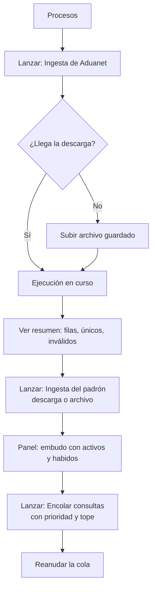
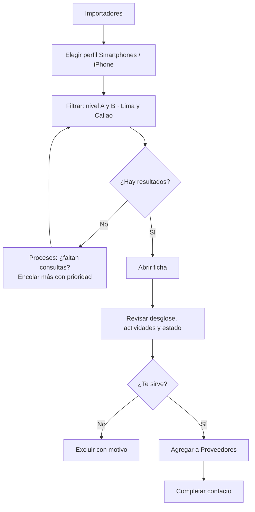
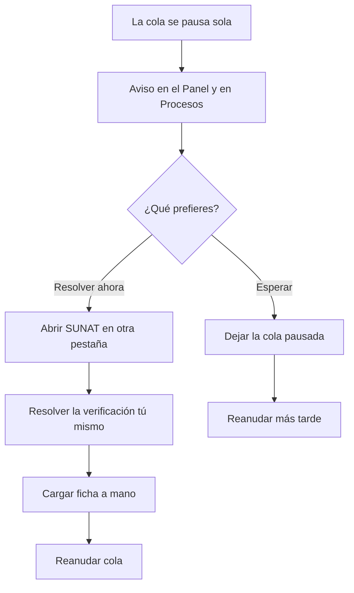
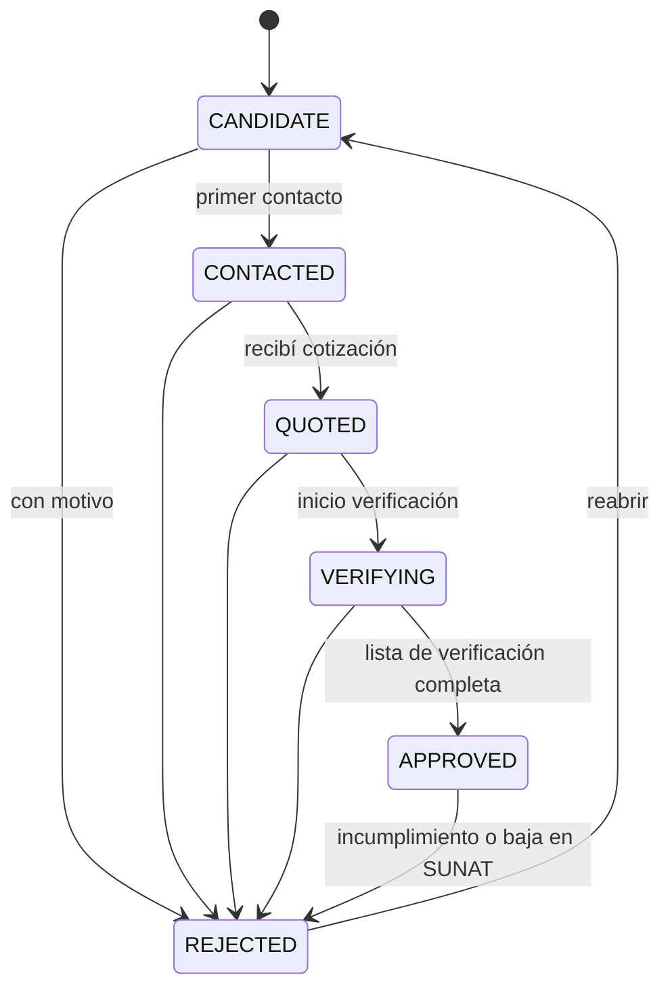

# 08 · UX y flujos

**Versión:** 0.2 (borrador) · **Fecha:** 25/10/2026
**Fuente:** `docs/02` (requerimientos) y `docs/06` (API).
**Alcance:** panel web interno, en español del Perú, pensado primero para escritorio y tablet.
**Nota:** los números de los bocetos son **ilustrativos**. Los reales se miden en el spike.

---

## 1. Principios de experiencia

1. **Responder primero «¿a quién le compro?».** La pantalla central es la lista ordenada de importadores con su nivel, no un panel de métricas.
2. **Explicar cada número.** Un puntaje sin su desglose no se muestra.
3. **Mostrar de dónde viene cada dato y qué tan viejo es.** «SUNAT · consultado hace 3 días».
4. **No fingir certeza.** El nivel A es una señal pública. La verificación humana es un paso explícito antes de aprobar.
5. **Las esperas se ven.** La cola, las ejecuciones y las pausas se muestran con su motivo y su siguiente paso.
6. **Cuando algo requiere a una persona, se dice con claridad** y se da el botón para hacerlo.
7. **Densidad útil.** Tablas compactas, filtros visibles y atajos de teclado para quien revisa cientos de filas.

## 2. Personas

| Persona | Qué busca | Rol |
| --- | --- | --- |
| **Administrador / desarrollador** | Cargar fuentes, vigilar el proceso, ajustar perfiles, invitar gente | `admin` |
| **Analista de compras** | Encontrar proveedores de iPhone, contactarlos, comparar cotizaciones, verificar y aprobar | `analyst` |
| **Lector** (socio o apoyo) | Ver avance y la lista de proveedores sin tocar nada | `viewer` |

> Hoy es **una sola persona: tú**, como administrador (D-10). Los otros dos roles son diseño para cuando se sume más gente.

## 3. Mapa del sitio

```
/login
/aceptar-invitacion/:token
/                      Panel (embudo)
/importadores          Listado
/importadores/:ruc     Ficha
/proveedores           Seguimiento
/proveedores/:id       Ficha del proveedor
/proveedores/comparar  Comparar cotizaciones
/procesos              Cola, tareas y ejecuciones
/ajustes/perfiles      Perfiles de puntuación (admin)
/ajustes/ciiu          Catálogo CIIU (admin)
/ajustes/usuarios      Usuarios e invitaciones (admin, posterior)
/ajustes/auditoria     Auditoría (admin)
/ajustes/cuenta        Mi cuenta
```

**Navegación principal:** Panel · Importadores · Proveedores · Procesos · Ajustes (solo `admin`). Arriba a la derecha van la **campana de avisos** (D-15), el usuario y el cierre de sesión.

## 4. Pantallas

### 4.1 Panel

Muestra el embudo, las cifras clave y los avisos. Un selector de perfil cambia los niveles y los puntajes.

```
┌────────────────────────────────────────────────────────────────────────────┐
│ Radar de Importadores   Panel · Importadores · Proveedores · Procesos   Tú ▾ │
├────────────────────────────────────────────────────────────────────────────┤
│ Panel                                Perfil: [Smartphones / iPhone v1 ▾]    │
│                                                                            │
│ ⚠ Cola pausada: SUNAT pidió verificación humana.                           │
│   [Cargar ficha a mano]  [Reanudar cola]                                   │
│                                                                            │
│ Embudo                                                                     │
│  Importadores únicos     41,377  ███████████████████████████████  100%     │
│  Activos y habidos       18,490  ██████████████                    45%     │
│  Consultados              1,760  ██                                4.3%    │
│  Nivel A, B o C             590  ▌                                         │
│  Nivel A o B                180  ▏                                         │
│  Proveedores aprobados        1  ▏                                         │
│                                                                            │
│ ┌──────────────┐ ┌──────────────┐ ┌──────────────┐ ┌──────────────┐        │
│ │ Nivel A   38 │ │ Nivel B  142 │ │ Consultas hoy│ │ Datos        │        │
│ │ Ver lista →  │ │ Ver lista →  │ │ 137 de 400   │ │ Aduanet 24/10│        │
│ └──────────────┘ └──────────────┘ └──────────────┘ │ Padrón  25/10│        │
│                                                    └──────────────┘        │
└────────────────────────────────────────────────────────────────────────────┘
```

- Cada barra del embudo es un **enlace** al listado ya filtrado.
- Debajo hay una **tabla alternativa** con los mismos números para lectores de pantalla.
- Los avisos de cola, de parser roto y de datos desactualizados aparecen **arriba**, con su acción.

### 4.2 Importadores (listado)

```
┌────────────────────────────────────────────────────────────────────────────┐
│ Importadores                                [Exportar ▾]  [Columnas ▾]     │
│ [🔍 Buscar RUC o razón social            ]  Perfil: [Smartphones / iPhone ▾]│
│ Filtros: [Nivel: A B ×] [Departamento: Lima ×] [Estado: ACTIVO ×] [+ Filtro]│
├──────┬───────────────────────────────┬──────┬────────┬────────┬────────────┤
│ Nivel│ Razón social · RUC            │Punt. │ Estado │Condic. │ Rubro      │
├──────┼───────────────────────────────┼──────┼────────┼────────┼────────────┤
│ [A]  │ EMPRESA EJEMPLO S.A.C.        │ 95   │ACTIVO  │HABIDO  │ 4652 princ.│
│      │ 20123456789 · Lima · 8 años   │ ▰▰▰▰▱│        │        │            │
│ [B]  │ OTRA IMPORTADORA S.R.L.       │ 64   │ACTIVO  │HABIDO  │ 4741 sec.  │
│ [ ]  │ SERVICIOS GENERALES … E.I.R.L │ —    │BAJA DE │HABIDO  │ Descartado │
│      │ 20526185847 · Piura           │      │OFICIO  │        │            │
├──────┴───────────────────────────────┴──────┴────────┴────────┴────────────┤
│ 50 por página · 1–50 de 1,450                         ‹ 1 2 3 … 29 ›       │
└────────────────────────────────────────────────────────────────────────────┘
```

- Por defecto se ve `SCORED` ordenado por puntaje descendente. Un interruptor **«Incluir descartados»** muestra el resto, con su motivo.
- La búsqueda tolera tildes y errores de tipeo. Buscar un RUC completo salta a su ficha.
- Cada fila: clic abre la ficha. Una casilla permite **agregar varios a Proveedores**.
- **Atajos:** `/` enfoca la búsqueda, `j` y `k` mueven la fila, `Enter` abre, `a` agrega a proveedores.
- Las columnas se muestran u ocultan y se recuerdan por usuario.

### 4.3 Ficha del importador

```
┌────────────────────────────────────────────────────────────────────────────┐
│ ‹ Importadores                                                             │
│ EMPRESA EJEMPLO S.A.C.                          [ACTIVO] [HABIDO] [Nivel A]│
│ 20123456789 [copiar]  ·  Lima  ·  Inscrita 12/03/2015 (11 años)            │
│ [Agregar a proveedores]  [Reconsultar]  [Ver en SUNAT ↗]  [Excluir…]       │
├────────────────────────────────────────────────────────────────────────────┤
│ Puntaje: 95 / 100  · Perfil Smartphones / iPhone v1                        │
│  Rubro               45/45  4652 actividad principal, peso 1.0             │
│  Antigüedad          25/25  11 años                                        │
│  Forma societaria    10/10  S.A.C.                                         │
│  Comprobantes         5/10  factura (sin emisión electrónica)              │
│  Logística           10/10  ubigeo 15 (Lima)                               │
│                                                                            │
│ ⓘ El nivel es una señal pública. No garantiza autenticidad de los equipos. │
├────────────────────────────────────────────────────────────────────────────┤
│ [Datos SUNAT]  [Actividades]  [Historial]  [Tareas]                        │
│  Tipo: SOCIEDAD ANONIMA CERRADA · Comercio exterior: IMPORTADOR            │
│  Fuente: SUNAT web · consultado hace 3 días                                │
└────────────────────────────────────────────────────────────────────────────┘
```

- **Pestañas:** *Datos SUNAT*, *Actividades* (principal y secundarias, con los códigos reconocidos resaltados), *Historial* (cambios de estado y condición) y *Tareas* (intentos de consulta con su resultado).
- Si el importador está descartado, la cabecera lo dice **en lugar del nivel**: «Descartado: estado BAJA DE OFICIO desde 31/10/2024».
- **Reconsultar** respeta la cola y el tope. Si la ficha es reciente, pide confirmación para forzarla.
- **Ver en SUNAT** abre la consulta oficial en otra pestaña.

### 4.4 Procesos

Tres bloques: **Cola de consultas**, **Tareas que necesitan a una persona** y **Ejecuciones**.

```
┌────────────────────────────────────────────────────────────────────────────┐
│ Procesos                                                                   │
│ Cola de consultas   ● Pausada · SUNAT pidió verificación humana            │
│   Pendientes 2,610 · En curso 0 · Hechas hoy 137 / 400 · Fallidas 9        │
│   [Reanudar]   Ritmo: 6 a 12 s ✎   Tope diario: 400 ✎  (solo admin)        │
│                                                                            │
│ Necesitan a una persona (1)                                                │
│   20525210686 DAVIS INTERNATIONAL PERU S.A.   [Abrir SUNAT ↗] [Cargar ficha]│
│                                                                            │
│ Ejecuciones                              [Lanzar ▾]                        │
│   #42 Ingesta Aduanet   ✔ 3 min 10 s   48,210 filas · 12 inválidas         │
│   #41 Padrón reducido   ✔ 11 min       18,490 elegibles                    │
│   #40 Puntaje           ✔ 8 s          1,450 puntuados                     │
└────────────────────────────────────────────────────────────────────────────┘
```

- **Lanzar** muestra solo lo que tu rol permite: *Encolar consultas*, *Recalcular puntajes* y, para `admin`, *Ingesta de Aduanet* e *Ingesta del padrón* (con opción de **subir archivo**).
- Una ejecución en curso muestra su avance con sondeo cada 5 segundos.

### 4.5 Cargar ficha a mano

Un formulario de una columna con los campos mínimos (estado, condición, comercio exterior, actividad principal, fecha de inscripción) y un panel lateral con **instrucciones**: «Abre la consulta de SUNAT en otra pestaña, resuelve la verificación y copia estos datos». Se validan los códigos CIIU de 4 dígitos. Al guardar, la tarea se cierra y la cola puede reanudarse.

### 4.6 Proveedores

Vista de **lista agrupada por estado** (también hay vista de tablero). Se puede filtrar por **categoría** (iPhone, laptops, accesorios, repuestos…):

```
┌────────────────────────────────────────────────────────────────────────────┐
│ Proveedores   [Lista | Tablero]   Categoría: [Todas ▾]   [Exportar]       │
│ Candidatos 12 │ Contactados 6 │ Cotizaron 3 │ En verificación 2 │ Aprobados 1│
│ ──────────────────────────────────────────────────────────────────────────│
│ EMPRESA EJEMPLO S.A.C.  [A 95]  iPhone, laptops  Contactado hace 2 días    │
│ OTRA IMPORTADORA S.R.L. [B 64]  Cotizó: iPhone 14 Pro reacond. US$680      │
└────────────────────────────────────────────────────────────────────────────┘
```

### 4.7 Ficha del proveedor

- **Cabecera:** nombre, RUC, nivel, estado de seguimiento y aviso si el estado en SUNAT cambió.
- **Pestañas:** *Resumen y contacto*, *Línea de tiempo* (notas, llamadas, mensajes, visitas, cambios), *Cotizaciones*, *Verificación*.
- **Verificación:** la lista de comprobación con quién y cuándo marcó cada punto. El botón **Aprobar** queda desactivado mientras falten puntos obligatorios y explica cuáles.
- Un botón con el número de WhatsApp o el teléfono abre la aplicación correspondiente. **Registrar** el contacto es manual. El sistema no envía mensajes.

### 4.8 Comparar cotizaciones

Se elige categoría, producto, capacidad y condición (y, para usados y reacondicionados, grado y salud mínima de batería). La tabla ordena por precio unitario y muestra proveedor, nivel, cantidad mínima, vigencia, si incluye IGV, garantía, plazo de entrega, stock y el estado de verificación. Las monedas **no se convierten** automáticamente. Una cotización vencida se ve atenuada y con la etiqueta «Vencida».

### 4.9 Perfiles de puntuación (admin)

Editor con los pesos y los códigos CIIU. Antes de guardar muestra una **vista previa del impacto**: cuántos importadores cambian de nivel (A↑, B↓…) con una muestra de ejemplos. Guardar crea una **versión nueva** y pide confirmar la recalculación.

### 4.10 Inicio de sesión, invitaciones y usuarios

- **Inicio de sesión:** correo y contraseña. Mensaje de error genérico. Sin enlace de «crear cuenta».
- **Aceptar invitación:** nombre y contraseña con indicador de longitud (mínimo 12) y sugerencia de usar una frase.
- **Usuarios (admin, posterior):** tabla con rol y estado, botón **Invitar** (muestra el enlace para copiarlo), cambiar rol, desactivar y restablecer contraseña.
- **Auditoría (admin):** tabla filtrable por usuario, acción y fecha.

## 5. Flujos

### F1 · Primera carga del universo (admin)



### F2 · Encontrar proveedores de iPhone (analista)



### F3 · SUNAT pide verificación humana (analista o admin)


Nunca hay un botón que intente «saltar» la verificación.

### F4 · Seguimiento de un proveedor



**Reglas de transición:** se puede avanzar saltando pasos (por ejemplo, de `CANDIDATE` a `QUOTED` si llegó una cotización de entrada), pero no retroceder. `REJECTED` exige motivo. `APPROVED` exige la lista completa. Reabrir un rechazado lo devuelve a `CANDIDATE` y queda en la línea de tiempo.

### F5 · Alerta de cambio en SUNAT

El sistema detecta que un proveedor en `VERIFYING` o `APPROVED` ya no es `ACTIVO` o `HABIDO` → agrega un evento `ALERT` en su línea de tiempo → muestra un aviso rojo en la ficha y en el Panel → el analista decide si lo rechaza. El sistema **no cambia el estado por su cuenta**.

### F6 · Invitar a una persona (admin) — posterior, cuando haya más usuarios

Ajustes → Usuarios → **Invitar** → correo y rol → se muestra el enlace de un solo uso (vence en 72 horas) → se copia y se envía por un canal seguro → la persona fija su contraseña → aparece como activa.

## 6. Lista de verificación de proveedores (valores de partida)

Plantilla `iphone-default` (equipos con IMEI). **Propuesta:** ajústala cuando quieras. Los ítems obligatorios bloquean la **aprobación**, no el **registro**: puedes anotar cotizaciones y datos de cualquier proveedor desde el inicio, porque el objetivo en esta etapa es reunir información para decidir (D-14).

Para accesorios, cargadores, repuestos y baterías se usa la plantilla `generic-default`: los mismos puntos de RUC, rubro, factura, contacto real, referencias, garantía y pago seguro, más **autenticidad o certificación** (por ejemplo, MFi en cables y cargadores de Apple) y **compatibilidad** con el modelo, en lugar de IMEI, región y bloqueo de activación.

| Clave | Texto | Obligatorio |
| --- | --- | :---: |
| `ruc_activo` | RUC **ACTIVO** y **HABIDO** comprobado en SUNAT (el sistema sugiere la fecha de la última consulta) | Sí |
| `rubro` | Actividad económica relacionada con electrónica o telecomunicaciones | Sí |
| `factura_electronica` | Emite factura electrónica a mi RUC | Sí |
| `contacto_real` | Hablé con una persona real que confirmó razón social y dirección | Sí |
| `referencias` | Contacté al menos 2 referencias comerciales | Sí |
| `procedencia` | Mostró comprobante de importación o factura de su proveedor del exterior | Sí |
| `condicion_equipo` | Condición de cada lote acordada por escrito: nuevo sellado, reacondicionado o usado (con grado, salud de batería y accesorios incluidos), y sin bloqueo de activación | Sí |
| `modelo_region` | Modelo y región compatibles con operadores del Perú (bandas y SIM física o eSIM) | Sí |
| `garantia` | Garantía por escrito: quién responde y por cuánto tiempo | Sí |
| `pago_seguro` | Forma de pago **sin adelanto total** (parcial o contra entrega) | Sí |
| `local_verificado` | Local o almacén verificado por visita o videollamada | No |
| `compra_prueba` | Compra de prueba pequeña antes del lote | No |
| `autorizado_apple` | Si declara ser distribuidor o revendedor autorizado de Apple, pidió el comprobante | No |
| `lista_precios` | Pidió lista de precios y stock disponible para poder comparar | No |
| `devoluciones` | Política de devoluciones o cambios por escrito | No |

## 7. Estados de la interfaz

| Pantalla | Cargando | Vacío | Error |
| --- | --- | --- | --- |
| Panel | Esqueleto del embudo | «Aún no hay datos. Empieza cargando la lista de Aduanet en **Procesos**» | «No pudimos cargar el embudo. Reintentar» |
| Importadores | Filas esqueleto | «Ningún importador coincide con estos filtros. [Limpiar filtros]» | «No pudimos cargar la lista. Reintentar» |
| Ficha | Esqueleto | «Este RUC no está en tu lista» | «No encontramos ese RUC» |
| Procesos | Indicadores | «Sin ejecuciones todavía» | «No pudimos leer la cola. Revisa que el worker esté activo» |
| Proveedores | Esqueleto | «Todavía no tienes proveedores. Empieza desde **Importadores**» | «No pudimos cargar los proveedores» |

## 8. Microcopy y avisos clave

| Situación | Texto (es-PE) |
| --- | --- |
| Aviso en toda ficha con nivel | «El nivel se calcula con datos públicos de SUNAT. No garantiza que el proveedor venda equipos originales. Verifica antes de comprar.» |
| Cola pausada por verificación | «SUNAT pidió una verificación humana. Pausamos las consultas para no insistir. Puedes resolverla tú o cargar la ficha a mano.» |
| Datos desactualizados | «Los datos de estado tienen más de 14 días. Actualiza el padrón para estar seguro.» |
| Descartado | «Descartado: estado BAJA DE OFICIO (desde 31/10/2024).» |
| Intento de aprobar sin completar | «Faltan 3 puntos obligatorios: garantía, pago seguro y procedencia.» |
| Fuente de un dato | «Fuente: SUNAT web · consultado el 22/10/2026» |
| Confirmación de exclusión | «¿Excluir a EMPRESA S.A.C.? No volverá a aparecer en los listados. Puedes restaurarla desde su ficha.» |

## 9. Accesibilidad y teclado

- Todo se maneja con teclado. El foco se ve siempre y se mueve a un lugar lógico al abrir y cerrar diálogos.
- El nivel, el estado y la condición **nunca dependen solo del color**: llevan texto y un ícono.
- Las tablas tienen encabezados asociados, orden anunciado y paginación accesible.
- El embudo tiene una **tabla equivalente**. Los medidores de puntaje muestran el número.
- Los avisos de estado (cola pausada, ejecución terminada) se anuncian con regiones `aria-live` educadas.
- Respeta `prefers-reduced-motion` y el modo oscuro del sistema (ver `docs/09`).

## 10. Qué se mide para mejorar la experiencia

- Tiempo desde abrir el listado hasta agregar un proveedor.
- Veces que se usa la vía manual por semana (indicador de fricción con SUNAT).
- Filtros más usados (para convertirlos en vistas guardadas).
- Intentos de aprobar con la lista incompleta (señal de que la lista es muy larga o está mal pensada).
