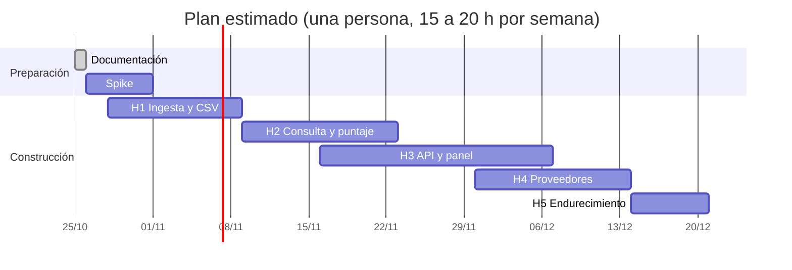

# 10 · Plan de desarrollo

**Versión:** 0.2 (borrador) · **Fecha:** 25/10/2026
**Fuente:** `docs/01` a `docs/09`.
**Supuesto de capacidad:** una persona desarrolladora a unas 15 a 20 horas por semana, apoyada por Claude. Si hay más gente, las fases H3 y H4 se pueden trabajar en paralelo con H2. **Los plazos son estimaciones**, no compromisos. Se recalibran al cierre del spike.

---

## 1. Estrategia

1. **Valor primero.** El primer lote de iPhone no puede esperar al panel. Primero un **CSV filtrado por línea de comandos** (H1), después consulta y puntaje (H2), y recién entonces la interfaz (H3).
2. **Eliminar dudas antes de construir.** La semana 1 es un *spike* para confirmar que podemos llegar a las fuentes, cuántas filas hay y cómo es el padrón.
3. **Cada fase termina en algo que se usa**, no en «código sin conectar».
4. **Puertas de decisión** (G0, G1, G2) para cambiar de plan si una fuente nos limita.

## 2. Resumen de fases

| Fase | Contenido | Semanas | Fechas estimadas | Entregable usable |
| --- | --- | :---: | --- | --- |
| **Fase 0** | Documentación (este conjunto) | — | Hasta el 25/10/2026 | `docs/` y `README` |
| **Spike** | Validar fuentes, volumen y campos | S1 | 26/10 al 01/11 | Informe de una página, *fixtures* y decisiones |
| **H1** | Ingesta + filtro en masa + CSV por CLI | S1–S2 | Hasta el 08/11 | **CSV de importadores ACTIVO + HABIDO** |
| **H2** | Cola de consulta RUC + puntaje + ficha manual | S3–S4 | 09/11 al 22/11 | **CSV con rubro y nivel (A–D) para iPhone** |
| **H3** | API + autenticación + panel (Panel, Importadores, Procesos, Usuarios) | S4–S6 | 16/11 al 06/12 | Panel interno funcionando |
| **H4** | Proveedores, cotizaciones, verificación y comparación | S6–S7 | 30/11 al 13/12 | Seguimiento completo de proveedores |
| **H5** | Endurecimiento, respaldos locales, reglas de avisos y revisión de seguridad. **Sin despliegue en servidor** (D-11) | S8 | 14/12 al 20/12 | Uso diario con respaldo y avisos |

## 3. Puertas de decisión

| Puerta | Cuándo | Pregunta | Si la respuesta es mala |
| --- | --- | --- | --- |
| **G0** | Fin del spike (01/11) | ¿Llegamos a Aduanet, al padrón y a la consulta RUC desde tu Mac? | Ingesta por **archivo cargado** como vía principal |
| **G1** | Fin de H2 (22/11), con una muestra de 300 consultas | Tasa de `PARSE_ERROR` < 2 % y de `NEEDS_HUMAN` < 5 % | Pasar a **ficha manual masiva** con ayuda de pegado de texto y bajar el ritmo. No hay presupuesto para proveedores de pago (D-12) |
| **G2** | Antes de H5 (13/12) | ¿Se abrirá el panel a más personas o a internet? | Revisión legal de datos personales y prueba de penetración básica antes de abrirlo |

## 4. El spike (semana 1)

Objetivo: reemplazar supuestos por datos. Todo se hace **desde tu equipo**, con el navegador y a mano o con scripts desechables.

| # | Tarea | Resultado esperado | Alimenta |
| --- | --- | --- | --- |
| SP-01 | Abrir la lista de Aduanet y guardar el HTML. Contar las filas. Anotar codificación y si hay más páginas o parámetros | Cantidad real, estructura, `fixture` | RNF (volumen), RF-ING-01 |
| SP-02 | Probar la descarga automática de la lista **completa** desde tu Mac (Aduanet ya respondió el 25/10 a una solicitud simple) | Que la descarga completa funciona y cuánto tarda | Riesgo R-01, G0 |
| SP-03 | Descargar el padrón reducido. Anotar tamaño, formato, delimitador, codificación, columnas y la fecha que declara | Especificación real del archivo | RF-ING-06, `docs/05` |
| SP-04 | Listar los valores distintos de `estado` y `condicion` del padrón | Valores exactos para los filtros | `docs/01` glosario, RF-FIL-01 |
| SP-05 | Cruzar la lista con el padrón en un script rápido y contar activos y habidos | **Tamaño real del embudo** | RNF §1, prioridad de la cola |
| SP-06 | **Tú lanzas** `scripts/spike/lookup_fetch.py` con la muestra de 20 RUC variados (activa, persona natural, S.A., E.I.R.L., sucursal…) más una baja, o las haces a mano si prefieres. Yo no ejecuto consultas contra esa página, porque su `robots.txt` bloquea a los agentes de Anthropic (D-18, D-21). Yo analizo las fichas guardadas | `fixtures` y campos completos (incluida la emisión electrónica) | RF-CON-02, `docs/05` §5 |
| SP-07 | Medir si aparece verificación humana y cada cuántas consultas | Tasa esperada de `NEEDS_HUMAN` | Riesgo R-02, G1 |
| SP-08 | Confirmar la tabla de CIIU del INEI para los códigos de partida | Descripciones oficiales | `docs/01` §6 |
| SP-09 | Leer la Política de Privacidad de SUNAT y el procedimiento ARCO, y buscar si Aduanet publica sus propias condiciones (los `robots.txt` ya se revisaron, `docs/01` §9.1) | Nota con conclusiones | D-18 |
| SP-10 | Redactar el informe de una página con decisiones y ajustes a los documentos | Informe + cambios en `docs/` | G0 |
| SP-11 | Medir la **huella en disco**: imágenes de Docker, base de datos y archivos (`du -sh`), y decidir si el worker corre fuera de Docker | Número real en GB | RNF-COS-04, `docs/04` §6.4 |

### 4.1 Resultados (25/10/2026)

El detalle está en [`12-informe-del-spike.md`](12-informe-del-spike.md): están hechas **SP-01 a SP-05**: la lista tiene 26,003 RUC únicos, 11,459 de ellos `ACTIVO` + `HABIDO`, y se descarga con una solicitud simple. Quedan pendientes SP-06 a SP-09 y la parte de Docker de SP-11. La puerta G0 se cumple en lo esencial.

## 5. Backlog por épica

**Estimación en días de trabajo efectivo** (rangos). Se suman a las 15 a 20 horas semanales.

### E1 · Fundaciones (H1)

| ID | Historia | RF / RNF | Días |
| --- | --- | --- | :---: |
| E1-01 | Repositorio, estructura de carpetas, `Makefile`, `pre-commit` y `.env.example` | RNF-MAN-04, RNF-SEG-05 | 0.5–1 |
| E1-02 | Docker Compose con PostgreSQL y Redis. Alembic con la primera migración | RNF-POR-01, RNF-MAN-05 | 1 |
| E1-03 | Integración continua: formato, tipos, pruebas, escáner de secretos y auditoría | RNF-MAN-01 a 04 | 1 |
| E1-04 | Núcleo: configuración, registros estructurados, errores y conexión a la base | RNF-OBS-01 | 1 |

### E2 · Ingesta (H1)

| ID | Historia | RF / RNF | Días |
| --- | --- | --- | :---: |
| E2-01 | Validador de RUC (formato, prefijo, dígito verificador) | RF-ING-04 | 0.5 |
| E2-02 | Parser de la lista de Aduanet (HTML y CSV) con normalización | RF-ING-01, 02 | 1–2 |
| E2-03 | Deduplicación, *upsert* por lotes y cuarentena | RF-ING-03, 04 | 1–2 |
| E2-04 | Snapshots, hash y ejecuciones (`pipeline_runs`) | RF-ING-05 | 1 |
| E2-05 | Lector de padrón en streaming con filtro por conjunto de RUC | RF-ING-06, RNF-REN-04 | 2–3 |
| E2-06 | Historial de cambios de estado y condición | RF-ING-08 | 1 |
| E2-07 | Validación de cordura del padrón (mínimo de filas) | RNF-FIA-03 | 0.5 |

### E3 · Filtrado y CLI (H1)

| ID | Historia | RF / RNF | Días |
| --- | --- | --- | :---: |
| E3-01 | Filtro `ACTIVO` + `HABIDO` con motivos de descarte | RF-FIL-01 | 1 |
| E3-02 | Comando `radar funnel` (embudo en consola) | RF-FIL-02, RF-OPS-03 | 0.5 |
| E3-03 | Comando `radar export` a CSV con filtros | RF-IMP-04, RF-OPS-03 | 1 |
| E3-04 | Comandos `radar ingest aduanet` y `radar ingest padron` | RF-OPS-03 | 0.5 |

**Hito H1:** `radar export --stage PADRON_CHECKED --out importadores.csv`.

### E4 · Consulta RUC (H2)

| ID | Historia | RF / RNF | Días |
| --- | --- | --- | :---: |
| E4-01 | Modelo y servicio de cola: reclamo con `SKIP LOCKED`, estados, latido y recuperación | RF-CON-01, RNF-FIA-02 | 2 |
| E4-02 | Interfaz `RucProvider` y pruebas de contrato | RF-CON-06, RNF-MAN-08 | 1 |
| E4-03 | Proveedor `sunat_web` con Playwright y parser (probado con *fixtures*) | RF-CON-02, RNF-MAN-02 | 3–4 |
| E4-04 | Detección de verificación humana y pausa automática | RF-CON-04, RNF-COR-05 | 1–2 |
| E4-05 | Ritmo, tope diario, reintentos con espera creciente | RF-CON-03, RNF-COR-01 a 04 | 1 |
| E4-06 | Caché con TTL y respuestas crudas | RF-CON-07, 08 | 1 |
| E4-07 | Ficha manual (servicio y comando `radar lookup manual`) | RF-CON-05 | 1 |
| E4-08 | Prioridad al encolar y comando `radar enqueue` | RF-FIL-03, 04 | 1 |
| E4-09 | Detección de cambio de formato y alerta | RF-CON-09 | 1 |
| E4-10 | Modo asistido (navegador visible) | RF-CON-11 | 1 |

### E5 · Puntaje (H2)

| ID | Historia | RF / RNF | Días |
| --- | --- | --- | :---: |
| E5-01 | Catálogo CIIU y semillas | RF-PUN-01 | 0.5 |
| E5-02 | Motor de puntaje (función pura) y desglose | RF-PUN-03, RNF-DAT-06 | 2 |
| E5-03 | Perfiles versionados y semillas de los cuatro perfiles (iPhone, laptops, accesorios, repuestos) | RF-PUN-02 | 1–1.5 |
| E5-04 | Recalculación por lotes sin reconsultar | RF-PUN-04, RNF-REN-05 | 1 |
| E5-05 | Comando `radar score` y exportación con puntaje | RF-OPS-03 | 0.5 |
| E5-06 | Tope de nivel por antigüedad (`tier_caps`) en el motor y en el desglose | RF-PUN-06 | 0.5 |

**Hito H2:** lista nivel A y B para iPhone en CSV.

### E6 · API y acceso (H3)

| ID | Historia | RF / RNF | Días |
| --- | --- | --- | :---: |
| E6-01 | Esqueleto de la API, errores RFC 9457, `request_id` y OpenAPI | `docs/06` | 1–2 |
| E6-02 | Inicio de sesión, sesiones en Redis, CSRF y primer administrador por CLI. Invitaciones y roles quedan para después | RF-AUT-01, 07, RNF-SEG-02, 03 | 2–3 |
| E6-03 | Dependencia de permisos (hoy solo `admin`) y prueba que recorre todas las rutas | RF-AUT-03, RNF-SEG-04 | 1 |
| E6-04 | Endpoints de importadores, ficha y exportación | RF-IMP-01 a 06 | 3 |
| E6-05 | Endpoints de pipeline, cola y tareas | RF-OPS-01, 02, 04 | 2 |
| E6-06 | Endpoints de puntaje y CIIU | RF-PUN-01, 02 | 1–2 |
| E6-07 | Auditoría | RF-AUT-05 | 1 |
| E6-08 | Cabeceras de seguridad, límites de tasa y CSP | `docs/07` §5 | 1 |
| E6-09 | Tabla `alerts`, endpoints de avisos y reglas que los generan (cola pausada, parser roto, datos viejos, cambio de estado de un proveedor) | RF-OPS-05, RF-PRO-07 | 1.5–2 |

### E7 · Panel (H3)

| ID | Historia | RF / RNF | Días |
| --- | --- | --- | :---: |
| E7-01 | Base Next.js, tokens del design system, cliente generado desde OpenAPI | RNF-MAN-06, `docs/09` | 2 |
| E7-02 | Inicio de sesión, aceptación de invitación y estructura de navegación | RF-AUT-01, 02 | 1–2 |
| E7-03 | Panel con embudo y avisos | RF-OPS-01 | 2 |
| E7-04 | Listado de importadores con filtros, búsqueda y exportación | RF-IMP-01, 03, 04 | 3–4 |
| E7-05 | Ficha del importador y desglose de puntaje | RF-IMP-02 | 2–3 |
| E7-06 | Procesos: cola, tareas manuales y ejecuciones | RF-OPS-02, RF-CON-10 | 2–3 |
| E7-07 | Formulario de ficha manual | RF-CON-05 | 1 |
| E7-08 | Auditoría (usuarios e invitaciones quedan para después) | RF-AUT-05 | 1 |
| E7-09 | Perfiles de puntuación con vista previa de impacto | RF-PUN-02 | 2 |
| E7-10 | Campana de avisos y banners | RF-OPS-05 | 1 |

### E8 · Proveedores (H4)

| ID | Historia | RF / RNF | Días |
| --- | --- | --- | :---: |
| E8-01 | Modelo y servicio de proveedores con transiciones y categorías | RF-PRO-01, 02, 10 | 1–2 |
| E8-02 | Contacto, línea de tiempo y notas | RF-PRO-03, 04 | 1–2 |
| E8-03 | Cotizaciones (con grado, batería, garantía, plazo y stock) y comparación | RF-PRO-05, 08 | 2–3 |
| E8-04 | Lista de verificación con bloqueo de aprobación | RF-PRO-06 | 1–2 |
| E8-05 | Interfaz: lista, tablero y ficha del proveedor | `docs/08` §4.6, 4.7 | 3–4 |
| E8-06 | Comparar cotizaciones (interfaz) | RF-PRO-08 | 1–2 |
| E8-07 | Exportar proveedores | RF-PRO-09 | 0.5 |

### E9 · Operación y endurecimiento (H5)

| ID | Historia | RF / RNF | Días |
| --- | --- | --- | :---: |
| E9-01 | Tareas programadas (reingesta semanal, reverificación de proveedores) | RF-ING-09, RF-PRO-07 | 1–2 |
| E9-02 | Avisos de respaldo atrasado y de datos desactualizados | RF-OPS-05, RNF-OBS-04 | 0.5–1 |
| E9-03 | Métricas `/metrics`, `/health`, `/ready` | RNF-OBS-03, 05 | 1 |
| E9-04 | `radar backup` y `radar restore` cifrados, y prueba de restauración | RNF-FIA-04 a 06 | 1–2 |
| E9-05 | Empaquetado local: `make up`, imágenes versionadas y vuelta atrás. Caddy y HTTPS solo si algún día se expone | RNF-POR-03, RNF-SEG-01 | 1 |
| E9-06 | Revisión de seguridad (lista de `docs/07` §12) | RNF-SEG-* | 1–2 |
| E9-07 | Pruebas de carga con datos sintéticos | RNF-REN-* | 1 |
| E9-08 | Accesibilidad: recorrido con teclado y lector de pantalla | RNF-USA-03 | 1 |

## 6. Estrategia de pruebas

| Nivel | Qué | Cuándo |
| --- | --- | --- |
| Unitarias | Validador de RUC, normalización, puntaje, prioridades | Con cada historia |
| Parsers con *fixtures* | HTML guardado de la lista y de la consulta. Casos: baja de oficio con 4 filas repetidas, personas naturales, E.I.R.L., sin actividades | Con E2-02 y E4-03 |
| Integración | Base de datos real, cola, reanudación tras reinicio, padrón en streaming con archivo sintético | H1 en adelante |
| Contrato | Proveedores de consulta y OpenAPI | H2 y H3 |
| Interfaz | Componentes (Vitest) y recorridos clave (Playwright): iniciar sesión, filtrar, ver ficha, agregar proveedor, aprobar | H3 y H4 |
| Seguridad | Ruta por ruta de roles, CSRF, límites de tasa, ZIP bomba | H3 y H5 |
| Humo en vivo | `radar smoke`: una consulta real a un RUC conocido. **Manual**, nunca en la integración continua | Antes de cada despliegue |

## 7. Definición de terminado (DoD)

Una historia está terminada cuando:

1. Cumple sus criterios de aceptación (ver `docs/02` §5).
2. Tiene pruebas y la integración continua pasa (formato, tipos, pruebas, escáner de secretos).
3. Las migraciones están versionadas y probadas hacia adelante.
4. No introduce datos personales en los registros.
5. La interfaz es accesible con teclado y cumple los contrastes de `docs/09`.
6. Actualizó la documentación afectada (`docs/` y el OpenAPI versionado).
7. Se mostró funcionando en la demostración semanal.

## 8. Modo de trabajo

- **Ramas:** una rama corta por historia, solicitud de cambios con revisión (aunque sea autorrevisión con Claude) y *squash merge*.
- **Mensajes de commit:** Conventional Commits (`feat:`, `fix:`, `docs:`…).
- **Demostración semanal** de 15 minutos con lo que ya funciona.
- **Decisiones** nuevas de arquitectura se agregan al registro de `docs/04` §9.
- **Preguntas abiertas** de `docs/01` §9 se cierran antes de la fase que las necesita.

## 9. Riesgos del plan

| Riesgo | Efecto en el plan | Respuesta |
| --- | --- | --- |
| Aduanet o SUNAT no son accesibles desde el servidor (R-01) | H1 se apoya en archivos subidos a mano | Opción A de `docs/04` (todo en tu equipo) |
| Mucha verificación humana (R-02) | H2 se alarga | Puerta G1 y proveedor de pago |
| Volumen mayor al esperado (R-06) | La cola tarda semanas | Priorización, detenerse al reunir suficientes nivel A, ritmo mayor con proveedor de pago |
| Poco tiempo disponible | Fechas se mueven | H1 y H2 son lo que **más valor da**. H3 a H5 se recortan antes |
| Cambios de HTML de SUNAT | Parches imprevistos | Parsers con *fixtures*, alerta y ficha manual |
| Dependencia de una sola persona | Riesgo operativo | Documentación viva, `Makefile` y respaldo de emergencia |

**Qué recortar primero si el tiempo se acaba:** vistas guardadas, modo asistido, comparación de cotizaciones, correos de alerta y segundo factor. **Lo que no se recorta:** validación de RUC, filtro por estado y condición, ritmo cortés, pausa por verificación humana y control de roles.

## 10. Cómo sabremos que funciona

| Indicador | Meta |
| --- | --- |
| Tiempo desde el spike hasta la primera lista de proveedores candidatos | ≤ 2 semanas |
| Importadores revisados a mano antes de llegar a la lista corta | Mínimo posible. Meta: solo los nivel A y B |
| Tasa de `PARSE_ERROR` en las consultas | < 2 % |
| Tasa de `NEEDS_HUMAN` | < 5 % |
| Proveedores aprobados con lista de verificación completa | 100 % |
| Costo mensual de infraestructura | US$ 0 |
